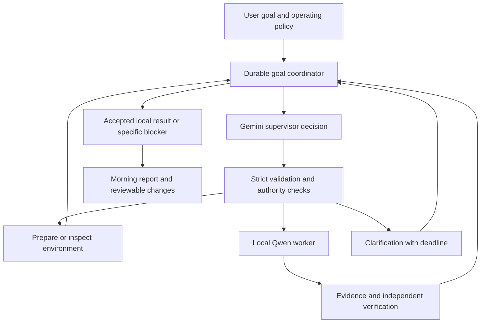

# Autonomous repository supervisor: requirements and implementation plan

Date: 2026-10-20  
Status: implementation underway; Phase 3 bounded repository-goal gate qualified on 2026-10-20  
Scope: replace chat-dependent campaign supervision with an integrated Gemini
supervisor, retain local coding workers, and prove reliable task completion.

## 1. Product intent and agreed decisions

The user should be able to give LoopForge a repository and a goal, leave it
working overnight, and return to verified, reviewable changes and an honest
account of what succeeded, failed, or requires a decision.

Supported goals include implementing features, investigating and fixing bugs,
and proactively improving a repository within an authorized scope.

The application must:

1. Understand the goal and establish observable acceptance criteria.
2. Inspect the repository and prepare an appropriate execution environment.
3. Break down work when useful, delegate it, and adapt based on evidence.
4. Evaluate worker results critically rather than trusting completion claims.
5. Recover from ordinary failures without requiring the user to supply each
   next step.
6. Ask the user only for consequential missing information or authority.
7. Continue useful authorized work while a clarification is pending.
8. When a configured clarification deadline expires, create a separate
   experiment branch/worktree from a recorded checkpoint, state assumptions,
   and pursue the best authorized interpretation.
9. Present the experiment in the morning so the user can keep useful changes
   and discard others.
10. Preserve work and report a specific blocker when further progress would
    exceed authority, budget, or available capabilities.

### Agreed model roles

- **Gemini 4 Argon** is the initial supervisor candidate, starting at medium
  reasoning. It replaces the supervising chat's planning, delegation, review,
  recovery, and coordination role.
- **Local Qwen workers** remain responsible for coding and local investigation.
  Moving coding to a frontier model is not the agreed direction.
- Only Gemini is in scope for paid API experiments. The user reports $15 of
  Gemini credits; that balance has not been independently verified.
- Qwen 3.8 27B and MLX serving are candidates to evaluate separately from the
  supervisor change.
- Gemini 3.8 Flash is a possible later cost comparison, not an initial routing
  layer that must be built.
- Start with one active coding worker. Multiple workers are not required to
  prove the product.

The user wants fewer predetermined reasoning steps while preserving trustworthy
execution controls. A plan should guide work and change with evidence; fixed
review lanes must not determine whether an arbitrary goal can be completed.

### Decisions still requiring configuration

These values are not yet agreed and must not be represented as user approval:

- Clarification timeout and morning report time/timezone.
- Which repositories and improvement categories may be worked on proactively.
- Per-experiment, per-goal, and overnight spending/time limits.
- Which verified local changes can be accepted automatically.
- Whether any remote push, PR creation, merge, deployment, or notification is
  authorized. A local experiment does not imply any of these permissions.
- Which repository material may be sent to the remote supervisor.

Provide explicit setup controls for these settings. A conservative first
evaluation should use local candidate branches, a named repository, and a small
spending cap within the available balance.

## 2. Findings that motivate the changes

Evidence below comes from the October 20 investigation. Historical runs span
different harness versions and selected tasks; counts are not a measured success
rate for the current implementation.

| Finding | Evidence | Required response |
| --- | --- | --- |
| Goal ownership remains outside the app | External monitor targets a Codex thread; issue promotion, contract preparation, recovery, and acceptance need supervising judgment | Put durable goal ownership inside LoopForge |
| Successful worker work can remain unfinished | Latest upload task `coding_7c443c3f7ba5` reached `patch_ready` October 16 and remained there at the October 20 snapshot | Define and implement the complete acceptance/delivery path |
| Review traversal is not task completion | 210 generic Brook reports; 180 contained unresolved questions | Track verified outcomes and unresolved obligations separately from traversal |
| Reporter can discard evidence discovered during investigation | In-memory reproduction showed additional lines in a required file removed by `mandatory_report_sources`; extra evidence from another file survived | Preserve relevant observed evidence and disclose omissions |
| Context admission and compaction impede continuity | Coding input uses a conservative serialized-byte allowance of 23,552 bytes for a nominal 32K context configuration; older traces show repeated reads/feedback without progress | Use provider-aware accounting and durable investigation memory |
| Passing checks can validate the wrong behavior | Earlier Unicode patch passed checks/review but failed 39 of 81 independently tested round trips; upload tests previously agreed with destructive behavior | Verify the authorized behavioral contract with independent evidence |
| Environment and regression preparation still require supervision | Recent ICS repair was accepted after supervisor replacement of the model's invalid regression script | Make reproduction and environment preparation first-class work |
| Guards stop runs without necessarily resolving goals | Context, no-progress, and attention outcomes require interpretation and a next decision | Add bounded, evidence-driven recovery |
| Existing tests do not establish autonomous reliability | 287 campaign tests passed in the earlier grounding pass, while actual task histories contain substantial intervention | Add complete-task evaluation with realistic failure cases |

Additional historical context:

- Recorded coding contracts: four accepted, six rejected, one `patch_ready`.
  Some accepted work had supervisor-prepared tests or patches.
- One older review made 70 actions without delivering a final report.
- One older coding attempt made 95 feedback/read actions and zero writes.
- The accepted ICS baseline at inspection was
  `ee079d0273fc2212e913eef8fefe517c64094aef`.
- Source/loaded-manifest comparison found no semantic differences during the
  inspection; the diagnosis is not explained solely by a stale service.
- A recent monitor heartbeat showed process activity, not proof of task
  progress. Do not equate a heartbeat with successful supervision.

### Main implementation locations to inspect

These are starting points, not a requirement to put new architecture into the
existing entrypoint modules:

- [Campaign dispatch and focused review prompts](../../src/loopforge/entrypoints/campaign.py)
- [Coding coordination and acceptance](../../src/loopforge/entrypoints/campaign_execution.py)
- [Coding workspace, tools, verification, and composition](../../src/loopforge/entrypoints/campaign_coding.py)
- [Review context, reporting evidence, and composition](../../src/loopforge/entrypoints/campaign_review.py)
- [Task configuration](../../src/loopforge/entrypoints/campaign_models.py)
- [Ollama context handling](../../src/loopforge/adapters/ollama_model.py)
- [Ollama profiles](../../src/loopforge/adapters/ollama_profiles.py)
- [Stop policy](../../src/loopforge/domain/policy.py)
- External supervisor:
  `/Users/rubensanchez/ai-platform/infra/campaign_monitor.py`
- [Existing campaign architecture](../architecture/campaign-harness.md)
- [Earlier reliability plan](campaign-harness-reliability-plan.md)

The current checkout contains extensive pre-existing changes. Implementation
must inventory and preserve them before making an isolated implementation
branch/worktree. Existing dated reports remain historical evidence; this
document proposes the next product direction.

## 3. Target architecture

### Separation of responsibilities

**Domain:** goal/task state, events, legal transitions, immutable authority and
budget contracts, clarification state, experiment lineage, and acceptance
records. No provider SDK, HTTP, Git, persistence, CLI, or telemetry imports.

**Application:** coordinate supervisor decisions, prepare context, validate
proposals, dispatch work through ports, reconcile results, enforce aggregate
budgets, and determine runnable work.

**Ports:** supervisor inference, worker execution, repository/environment
operations, verification, clock, persistence, and delivery as needed. Review
existing abstractions before adding overlapping interfaces.

**Adapters:** Gemini transport and usage accounting, Ollama/MLX workers,
container execution, Git/worktrees, storage, and optional external scheduling.

**UI/API:** submit goals, configure operating policy, answer questions, inspect
evidence/diffs/cost, pause or cancel, and accept or discard results.

The model proposes decisions. Code validates them and executes authorized
actions. A model response cannot grant permissions, weaken verification, change
hard limits, or directly rewrite authoritative state.

### Durable goal ownership

Separate a long-lived goal from its bounded worker runs. A failed or terminal
worker run remains terminal; a coordinator may create a successor attempt only
within the goal's remaining authority and aggregate budget.

Persist:

- Original goal, constraints, acceptance criteria, and authorized scope.
- Current plan, dependencies, rationale, and revisions.
- Repository checkpoint, candidate branches, and experiment lineage.
- Attempt history and evidence references.
- Pending questions, deadlines, answers, and assumptions.
- Usage, budget reservations, failures, and next eligible action.
- Result disposition and final/morning summary.

Event/reducer transitions must make crash recovery deterministic. The UI and
scheduler consume projections; neither becomes a second source of truth.

## 4. Make the reasoning loop simpler

Use a small set of meaningful supervisor capabilities:

- Inspect repository state and retrieve relevant evidence.
- Prepare an authorized environment.
- Delegate investigation or implementation with an outcome and constraints.
- Request verification or review.
- Revise the plan using observed results.
- Ask a question, create an authorized experiment, or record a blocker.
- Propose completion with evidence for each acceptance criterion.

Do not require every task to traverse map/bugs/boundaries/contracts/docs/
challenge/reconcile lanes. Retain useful audits as optional strategies.

Do not turn every possible cognitive step into a separate tool or model call.
Keep schemas strict at execution boundaries while allowing a flexible plan.
Remove project-specific corrective prompts as general behavior becomes covered
by reusable tools, clear contracts, and regression evaluations.

Every delegated task needs enough structure to be executable: objective,
checkpoint, expected behavior, allowed scope, verification expectations,
dependencies, and allocated limits. It should not require the user to manually
specify every file or discover the solution first.

The supervisor may propose narrower task contracts inside preauthorized
repository policy. Code resolves paths, images, commands, and capabilities
against approved options. Repository instructions cannot expand that authority.

## 5. Clarification timeout and overnight experiments

Distinguish three question classes:

| Question | Deadline behavior |
| --- | --- |
| Optional preference or implementation ambiguity within scope | Continue independent work; after deadline, record an assumption and branch an experiment |
| Missing information needed for the entire task | Work on independent tasks if available; otherwise preserve progress and report the blocker |
| Required permission or immutable policy decision | Do not infer approval from silence; continue only separately authorized work |

For an eligible timeout:

1. Persist the pending question, deadline, allowed fallback, and checkpoint.
2. On expiry, atomically record the assumption and experiment intent.
3. Create a unique candidate branch/worktree from the recorded checkpoint.
4. Work only within the original authorized scope and remaining budget.
5. Verify and retain changes as a candidate, without silently merging them into
   the user's current work.
6. Report the unanswered question, chosen interpretation, alternatives,
   resulting changes, verification, and remaining uncertainty.

Timeout delivery and branch creation must be idempotent across restarts.
Record the actual commit and authorized working-tree snapshot used; do not
silently omit uncommitted user work when interpreting “where we are.”

A late user response must be reconciled with the experiment's current state.
Stop conflicting future actions, preserve completed work, and record the changed
direction. Do not silently discard work or apply incompatible results.

Branch/worktree separation prevents changes from mixing; it is not a sandbox.
Execution isolation remains the responsibility of the sandbox capability
contract.

## 6. Evidence, context, and verification

### Evidence preservation

- Fix filtering that strips newly observed lines from files with predetermined
  required intervals.
- Keep source hash, revision, path, ranges, truncation, and observation identity.
- Let the supervisor retrieve original evidence rather than relying exclusively
  on worker summaries.
- Include relevant discovered evidence in reporting. When capacity prevents
  inclusion, explicitly identify omissions and allow retrieval/decomposition.
- A citation establishes provenance, not the truth of an inference.
- Repository text, tool output, and worker conclusions remain lower-trust
  content. None can redefine runtime policy.

### Context lifecycle

- Measure provider input with the appropriate tokenizer/counting endpoint or a
  documented conservative estimator; distinguish bytes from tokens.
- Reserve space for output, tool schemas, and provider reasoning behavior.
- Persist compact task memory: discoveries, rejected hypotheses, decisions,
  changed files, current failures, and next steps, with links to raw evidence.
- Preserve model-specific reasoning/tool-call metadata when required by the
  provider protocol. Do not blindly copy Ollama settings to Gemini.
- Compact without erasing critical unresolved obligations or authority.
- Treat missing history explicitly; retrieve evidence instead of fabricating
  continuity.
- Preserve stable prompt prefixes where useful for caching.

### Verification contract

Keep separate records for:

1. Worker says implementation is complete.
2. Commands/checks passed on a specific revision.
3. Original failure reproduced or feature behavior specified.
4. Candidate fixes that failure or implements that behavior.
5. Relevant regressions and edge cases pass.
6. Supervisor assesses acceptance criteria against evidence.
7. Code-owned acceptance policy allows local acceptance or requires a user.
8. Result is delivered with a reviewable diff and evidence.

Verification should happen at meaningful checkpoints and explicit completion,
with targeted checks during work when useful. Passing an intermediate check
must not automatically end a still-incomplete multi-part task.

Separate editable project tests from trusted acceptance fixtures. Workers may
need to update project tests, but cannot redefine the sole grader of their own
success. For bug repairs, use a failing baseline/negative control where feasible.
For features, verify observable behavior and relevant existing behavior.

Fresh supervisor review must inspect the actual patch and execution evidence,
not merely endorse the worker's report. Model review supplements executable
checks; it does not establish correctness by itself.

## 7. Environment preparation and recovery

Provide a usable development environment before assigning implementation:

- Detect repository language/toolchain and available test commands.
- Select or prepare an approved, reproducible environment.
- Establish baseline failures separately from introduced failures.
- Support bounded exploratory commands in an isolated workspace where authorized.
- Capture meaningful command output, exit status, revision, and artifacts.
- Make fixture/environment preparation a supervised task when it is missing.

Classify failures so the supervisor can respond productively:

| Failure | Possible bounded response |
| --- | --- |
| Transient provider/service failure | Retry with backoff within original limits |
| Unknown side-effect outcome | Reconcile receipts/state before retrying |
| Invalid model output | Bounded schema-repair attempt; retain diagnostic |
| Context pressure | Retrieve/compact/decompose with preserved obligations |
| Missing environment dependency | Use approved preparation path or report blocker |
| Incorrect patch | Return concrete failing evidence and revise assignment |
| No progress/repeated evidence | Change approach or stop the attempt |
| Missing permission or unsupported isolation | Block dependent execution |
| Exhausted goal budget | Preserve results and stop further paid work |

Retries and new attempts share the goal budget. They cannot reset spending,
iteration, or time limits to evade a hard cap. No-progress detection should
consider changed evidence, reproduced behavior, meaningful edits, and verified
criteria, not merely count different tool calls.

## 8. Gemini integration and cost controls

Implement Gemini through an adapter behind the supervisor port. Keep provider
objects and loosely typed payloads outside the core.

Required capabilities:

- Strictly validated decisions and function arguments.
- Correct multi-turn/tool-result handling and provider metadata preservation.
- Bounded output and appropriate reasoning configuration.
- Explicit timeout, retry, cancellation, and uncertain-response behavior.
- Usage accounting including billed thinking and cached input where reported.
- Traceable model/version/settings for every evaluation and production run.
- Redacted errors and credentials excluded from prompts, logs, and worker envs.

The credential currently resides in `.loopforge/secrets.env` as
`GEMINI_API_KEY`; the directory is Git-ignored. Add deliberate loading/configuration
support without exposing the value. Prefer passing only necessary repository
context to Gemini, with secret exclusion and an explicit data-sharing policy.

Smoke test already performed:

- Model: `gemini-4-argon`.
- Result: successful generation.
- Usage: 38 input tokens, 7 output tokens.
- Observed latency: 17.2 seconds.
- Estimated standard token charge: $0.000146.

This tests connectivity only. It does not establish supervisor quality, latency
under load, billing balance, or a reliable cost forecast.

At the October 20 documentation snapshot, standard Argon pricing is $2/million
input tokens and $10/million output tokens, including thinking, through November
30; listed prices double December 1. Verify prices again before implementation
experiments. A 20K-input/3K-output decision is approximately $0.07 before caching
or additional tool charges.

Implement atomic budget reservations before calls using conservative maximum
charges, reconcile with actual usage, and handle missing usage conservatively.
Count retries and concurrent reservations. Stop before the authorized cap;
never rely on the account running out of credits to enforce an app budget.

## 9. Local worker and inference evaluation

First establish whether the integrated supervisor can direct the existing local
worker successfully. Then compare Qwen 3.8 27B on the same tasks. Finally compare
Ollama and an MLX serving implementation with matched model/settings as closely
as available artifacts permit.

Evaluate:

- Correct task completion and amount of supervisor intervention.
- Tool-call validity and behavior under context pressure.
- Prompt processing, generation, warm-cache behavior, and total elapsed time.
- Memory use, supported context, cancellation, and restart behavior.
- Quantization differences and model-template/reasoning compatibility.

Do not claim MLX is a drop-in native Ollama API replacement or promise a fixed
speedup. Existing local benchmarks favored the A3B model's speed over dense 27B
on Ollama, while public M1 Max MTPLX microbenchmarks suggest potential improvement
for 27B. Neither establishes full-task reliability.

The worker should retain the same authority and observable evidence contract
across backends. Choose the backend by measured complete-task performance.

## 10. User experience and morning delivery

Expose a goal view with:

- Goal, current plan, completed criteria, and current activity.
- Candidate branches and diffs tied to exact revisions.
- Questions with deadlines and explicit fallback behavior.
- Assumptions and experimental work clearly identified.
- Budget used/reserved/remaining and last meaningful progress.
- Blockers with evidence and the smallest decision needed.
- Pause/cancel controls with accurate in-flight action status.

The morning report should answer:

1. What changed, and why?
2. Which requested outcomes were verified?
3. What tests or checks support that claim?
4. What assumptions were made while the user was unavailable?
5. What failed or remains uncertain?
6. Which branches/patches can be accepted independently?
7. How much time and API budget were consumed?

Support an in-app report first. External messaging needs its own authorized
delivery configuration. “Accepted locally,” “candidate ready,” “merged,” and
“deployed” must remain visibly distinct.

## 11. Implementation sequence and completion gates

Each phase should be a reviewable change with evidence. Checkboxes represent
future work, not completed implementation.

### Phase 0 — Preserve baseline and freeze evaluation cases

- [x] Inventory existing dirty/untracked work and capture reproducible baselines.
- [x] Confirm current loaded service, pending tasks, environment, and model setup.
- [x] Record representative tasks and expected outcomes before changing prompts.
- [x] Configure explicit evaluation budget and remote-data scope (synthetic fixtures only).
- [x] Preserve existing campaign state; do not replay pending side effects.

Gate: comparison cases, state backup, and authorized test limits are recorded.

### Phase 1 — Repair evidence and completion foundations

- [x] Reproduce and fix same-file discovered-evidence loss.
- [x] Correct context accounting and observable truncation.
- [x] Separate intermediate check success from whole-task completion.
- [x] Preserve acceptance evidence tied to exact revisions.
- [x] Separate trusted acceptance checks from editable project tests.

Gate: deterministic regressions pass for evidence retention, multi-part
completion, stale receipts, misleading tests, and failure behavior.

Qualification: 2,888 passed, 63 skipped, 92% coverage. Prepared Python
acceptance probes were exercised through real container execution, a persisted
restart, fresh review and local acceptance. See
[the progress record](autonomous-supervisor-progress.md) and
[ADR-0017](../decisions/ADR-0017-trusted-acceptance-and-context-admission.md).
Legacy checks-only tasks retain their prior meaning; this is not live supervisor
or overnight qualification.

### Phase 2 — Durable goal coordinator and Gemini supervisor

- [x] Add domain events/reducers and persisted goal/attempt/decision state.
- [x] Add provider-independent supervisor port and Gemini adapter.
- [x] Validate proposed actions against code-owned policy.
- [x] Add aggregate budget reservation/reconciliation and bounded recovery.
- [x] Connect one local worker and verification path.
- [x] Replace external chat acknowledgement as a progress dependency.

Gate: one prepared bounded task completes from intake through local acceptance
or candidate delivery without chat intervention; restart resumes correctly.

Qualification: a clean generated arithmetic task completed with Gemini Argon and
local Qwen, automatic service restart before fresh review, independent container
checks and candidate delivery. No chat intervention or implementation repair was
needed during the clean run. A preceding run exposed and helped repair integration
defects; its intervention and cost remain recorded. Total conservatively accounted
Gemini spend: $0.021008 of the authorized $5. Only generated fixture material was
shared. This is a prepared-task gate, not general autonomous/overnight qualification.
See [ADR-0018](../decisions/ADR-0018-durable-prepared-goal-supervisor.md) and the
[operator guide](../architecture/prepared-goal-supervisor.md).

### Phase 3 — Flexible investigation and task preparation

- [x] Let supervisor inspect, reproduce, prepare environment, and delegate.
- [x] Replace mandatory lane traversal with adaptive planning.
- [x] Add durable investigation memory and original-evidence retrieval.
- [x] Recover from environmental, model, and verification failures distinctly.
- [x] Process ready results and remaining obligations without manual nudges.

Gate: a multi-file task with an ordinary injected failure completes without
the user preparing exact edit locations or repairing the harness.

Qualification: a generated multi-file quantity-summary task completed with
Gemini and the local worker after scoped source discovery, approved environment
preparation, independent baseline reproduction, automatic restart, a bounded
worker-model recovery, fresh review and candidate delivery. The run recovered
from an explicitly injected transient container failure and an unavailable pytest
dependency without chat intervention or harness repair during the clean trial.
An earlier directory-inventory defect and its blocked trial remain recorded.
Total Gemini accounting across Phases 2–3 is $0.114208 of $5. See
[ADR-0019](../decisions/ADR-0019-repository-investigation-and-task-preparation.md)
and the [repository-goal guide](../architecture/repository-goal-supervisor.md).
This gate uses frozen scope, approved installed environments and independently
specified behavioral probes; it is not general overnight qualification.

### Phase 4 — Clarifications, experiments, and review experience

- [x] Persist questions, deadlines, fallback classification, and late answers.
- [x] Implement idempotent experiment branching from a recorded checkpoint.
- [x] Reconcile dirty working-tree state without disturbing user work.
- [x] Add goal progress, diffs, cost, assumptions, and morning report views.
- [x] Add accept/discard and pause/cancel behavior with clear disposition.

Gate: simulated user absence produces a verified isolated candidate and morning
report; silence never grants prohibited authority.

Qualified with generated multi-file fixtures over real containers, dirty and
staged/untracked source preservation, timeout and restart, independent receipts,
accept/discard, concurrent control races, and browser review. Questions/fallbacks
are trusted intake (one topic/experiment per goal); arbitrary model-generated
question topics and in-place conflict replanning remain unsupported. See
[ADR-0020](../decisions/ADR-0020-clarification-experiments-and-goal-review.md).

### Phase 5 — Qualification and local model/backend comparison

- [ ] Run the frozen complete-task suite with Argon and existing local worker.
- [ ] Compare Qwen 3.8 27B under the same supervisor/environment.
- [ ] Evaluate an MLX server if worker quality justifies the integration.
- [ ] Consider Flash only after establishing an Argon quality baseline.
- [ ] Publish results, failures, interventions, spend, and selected configuration.

Gate: meet the agreed reliability threshold before enabling unattended work.

### Phase 6 — Controlled overnight rollout

- [ ] Start with one authorized repository and bounded local candidate changes.
- [ ] Exercise restart, timeout, budget, and cancellation under realistic use.
- [ ] Disable overlapping legacy chat dispatch for the migrated goal.
- [ ] Keep n8n/Hub as optional triggers/views, not owners of semantic progress.
- [ ] Update architecture/runbooks to describe actual deployed behavior.

Gate: complete multiple unattended sessions with accurate morning reports and
no manual recovery hidden from the recorded results.

## 12. Acceptance test matrix

Unit tests must not access the network. Use deterministic provider fixtures and
fake clocks for control behavior. Live model evaluation is a separate bounded,
explicitly configured suite. Every new control needs allowed and denied/failure
tests per AGENTS.md.

| Scenario | Required observable result |
| --- | --- |
| Simple bug repair | Failure reproduced, candidate fixes it, relevant checks pass, result delivered |
| Multi-file feature | All acceptance criteria satisfied; first green edit does not terminate work |
| Tests encode existing bug | Supervisor challenges behavior using the authorized requirement; cannot pass by endorsing the same faulty test |
| Worker claims success without evidence | Verification required; no acceptance based on prose alone |
| Additional evidence in required file | Newly observed lines survive reporting or remain explicitly retrievable |
| Context compaction | Critical constraints, discoveries, and unresolved obligations survive |
| Missing dependency | Approved environment recovery or precise blocker; no fabricated check result |
| Worker repeats reads | Bounded intervention changes approach or stops; no endless paid loop |
| Transient API failure | Bounded retry with accounted usage and no duplicated side effect |
| Unknown command outcome | Reconcile before retry; no duplicate commit/branch/dispatch |
| Supervisor/service restart | Resume persisted work without lost questions or duplicate actions |
| Clarification expires | Authorized assumption creates one isolated experiment |
| Permission request expires | Restricted action remains blocked |
| User responds late | Reconcile answer and preserve experiment history |
| Dirty user checkout | User changes retained; experiment base recorded accurately |
| Candidate review succeeds | Goal progresses to authorized disposition without chat acknowledgement |
| Goal budget exhausted | No further paid calls; preserve work and report budget stop |
| Cancellation | Stop new work, reconcile in-flight execution, preserve accurate status |
| Malicious repository/tool text | Cannot expand permissions, expose credentials, or alter trusted policy |
| Morning delivery | Diff, evidence, assumptions, failures, and spend agree with persisted events |

### Suggested evaluation bar

These are proposed rollout gates, not an established success claim:

- Freeze at least 10 representative bounded tasks and repeat each three times
  where the evaluation budget allows. Report the actual sample size if smaller.
- Require all authority, budget, idempotency, and state-transition gates to pass.
- Target at least 90% correct completion without human intervention on the
  bounded task suite; count timeouts and exhausted runs as failures.
- Require zero false acceptance on the seeded deceptive-success cases.
- Complete three bounded unattended sessions without hidden operator repair.
- Independently inspect results; the supervisor must not be its sole grader.

Report both per-task repeat consistency and aggregate success. This small suite
is an engineering gate, not statistical proof of general overnight reliability.

Primary metrics:

- Correct accepted/delivered outcomes per attempted task.
- Human interventions and supervisor recoveries per task.
- False acceptance, missed defects, and regressions.
- Total elapsed time and cost per correct completion.
- Time spent generating versus processing prompts versus executing tools.
- Restart recovery, unanswered-question behavior, and budget-stop correctness.

## 13. Research basis and limits

- [Anthropic: Building effective agents](https://www.anthropic.com/engineering/building-effective-agents)
  supports simple composable approaches and choosing workflow versus agent
  behavior deliberately.
- [Anthropic: Effective harnesses for long-running agents](https://www.anthropic.com/engineering/effective-harnesses-for-long-running-agents)
  emphasizes prepared environments, persistent progress, incremental work, and
  end-to-end verification.
- [Cursor: Continually improving the agent harness](https://cursor.com/blog/continually-improving-agent-harness)
  describes adapting tools and removing unnecessary scaffolding as models improve.
- [Anthropic: Agent evaluations](https://www.anthropic.com/engineering/demystifying-evals-for-ai-agents)
  supports grading environmental outcomes and the complete agent system.
- [Gemini 4 Argon documentation](https://ai.google.dev/gemini-api/docs/latest-model?hl=en)
  describes reasoning controls and integration requirements.
- [Gemini pricing](https://ai.google.dev/gemini-api/docs/pricing)
  is the source for the dated cost estimates above.
- [Google's Argon announcement and evaluations](https://blog.google/innovation-and-ai/models-and-research/gemini-models/gemini-4-argon/)
  provides promising long-running-task evidence, not validation of LoopForge.
- [Qwen 3.8 27B model card](https://huggingface.co/Qwen/Qwen3.8-27B)
  documents model-specific settings and evaluations under different harnesses.
- [MLX LM](https://github.com/ml-explore/mlx-lm),
  [oMLX](https://github.com/jundot/omlx), and
  [M1 Max MTPLX benchmark](https://github.com/Takuyan-labs/qwen38-m1max-mtplx-benchmark)
  inform the optional local-serving experiment.

Model benchmarks and user reports help select candidates. Only the complete-task
evaluation can establish whether the chosen supervisor, worker, environment,
and application satisfy this product's requirements.

## 14. Definition of done

LoopForge can accept a bounded repository goal, plan and execute authorized work,
recover from ordinary failures, verify the outcome, handle user absence through
isolated authorized experiments, and deliver reviewable results without this
chat driving the next step. Its persisted evidence explains what happened and
supports its completion claims. It stops honestly when authority, resources, or
information prevent further progress.

This report authorizes no deployment, migration, model installation, or
unattended campaign by itself. It is the implementation and evaluation plan
requested by the user.
